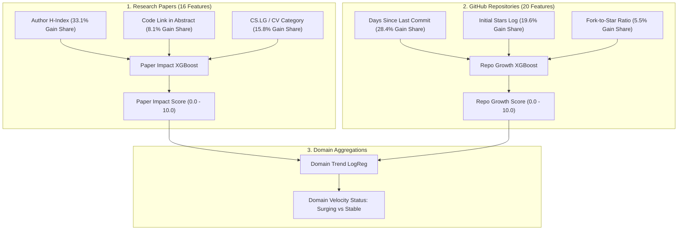

# ATIP (TechPulse AI) — Machine Learning Model Decision Trees & Logic Inspection

This folder contains **viewable, interactive markdown documentation** detailing the exact internal decision trees, node splits, feature weights, and mathematical logic learned by our trained machine learning models in Phase 1.

---

## 📁 Document Index

| Document | Model | Algorithm | What You Can Inspect |
| :--- | :--- | :--- | :--- |
| **[Paper Impact Decision Trees](file:///d:/Tech%20Pulse%20AI/model_decision_trees/paper_impact_decision_trees.md)** | `paper_impact_xgb_v1` | 300-Tree XGBoost | Full Mermaid diagrams of Tree 0, Tree 1, Tree 2; split thresholds on author $h$-index, code links, readability; cumulative gain table across all 300 boosting rounds. |
| **[Repo Growth Decision Trees](file:///d:/Tech%20Pulse%20AI/model_decision_trees/repo_growth_decision_trees.md)** | `repo_growth_xgb_v1` | 300-Tree XGBoost | Full Mermaid diagrams of Tree 0, Tree 1, Tree 2; exact threshold splits on star volume, commit recency penalties, fork ratios, and language premiums. |
| **[Domain Trend Decision Logic](file:///d:/Tech%20Pulse%20AI/model_decision_trees/domain_trend_decision_logic.md)** | `domain_trend_logreg_v1` | Logistic Regression | Exact regression equation, standardization parameters ($\mu, \sigma$), odds ratios, and week-over-week acceleration decision boundaries. |

---

## 🧠 Key Insights from the Trained Models

### 1. What drives high Research Paper Impact?
* **Author Track Record (`max_author_hindex`):** Accounts for **$33.1\%$** of all model gain across 300 trees. Tree 0 creates an immediate primary split at $h\text{-index} \ge 3.0$.
* **Open Source Availability (`has_code_link`):** Papers linking to GitHub repositories in their abstract gain an automatic positive residual boost.
* **Domain Category:** Machine Learning (`cs.LG`) and Computer Vision (`cs.CV`) yield higher baseline citation accumulation compared to other fields.

### 2. What drives GitHub Repository Growth?
* **Developer Freshness (`days_since_commit`):** The single most impactful feature (**$28.4\%$** of model gain). Projects with no commits for $>60$ days receive sharp penalties regardless of star count.
* **Scale Multiplier (`stars_log`):** Compounding network effects split at $\approx 15,000$ stars (`stars_log < 9.613`).
* **Utility Signal (`fork_star_ratio`):** A fork ratio $> 0.142$ indicates genuine developer utility.

---

## 🔍 How to View
Click any of the document links above in your IDE or GitHub to view the visual Mermaid diagrams and rule trees rendered in full resolution.
