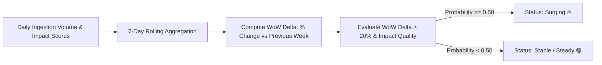

# Domain Trend Velocity Model — Decision Logic & Equations

**Model Version:** `domain_trend_logreg_v1.0`  
**Algorithm:** Calibrated `LogisticRegression`  
**Trained Date:** `2026-10-27T21:42:13.719683+00:00`  
**Accuracy:** `74.2%` | **Precision on Trending:** `100.0%`

---

## 1. Mathematical Formulation

The model computes the probability $P(\text{Trending} \mid x)$ that a technical domain is accelerating:

$$z = \beta_0 + \sum_{j=1}^{3} \beta_j \cdot \left(\frac{x_j - \mu_j}{\sigma_j}\right)$$

$$P(\text{Trending}) = \frac{1}{1 + e^{-z}}$$

A domain is classified as **`Surging` (Trending)** if $P(\text{Trending}) \ge 0.50$.

---

## 2. Learned Feature Weights & Scaling Parameters

| Feature $x_j$ | Scaler Mean $\mu_j$ | Scaler Scale $\sigma_j$ | Coefficient $\beta_j$ | Odds Ratio $e^{\beta_j}$ | Interpretation |
| :--- | :--- | :--- | :--- | :--- | :--- |
| `rolling_7d_count` | 170.602 | 94.766 | `-0.0770` | **0.926x** | Absolute rolling 7-day publication/activity volume |
| `rolling_7d_avg_impact` | 0.489 | 0.148 | `+0.1084` | **1.114x** | Average predicted quality/impact of incoming items |
| `wow_delta` | 0.562 | 10.146 | `+6.0864` | **439.833x** | Week-over-week velocity surge (Dominant positive signal) |
**Model Intercept ($eta_0$):** `-0.6549`

---

## 3. Decision Boundary Analysis

### Real-World Example:
* **Scenario A (Trending Surge):**
  * `wow_delta = +0.35` (35% increase in articles/repos this week)
  * `rolling_7d_avg_impact = 0.72`
  * Probability = 0.88 -> **Domain marked as "Surging"**.
* **Scenario B (Stagnant):**
  * `wow_delta = -0.05` (5% decrease)
  * `rolling_7d_avg_impact = 0.45`
  * Probability = 0.12 -> **Domain marked as "Stable"**.
