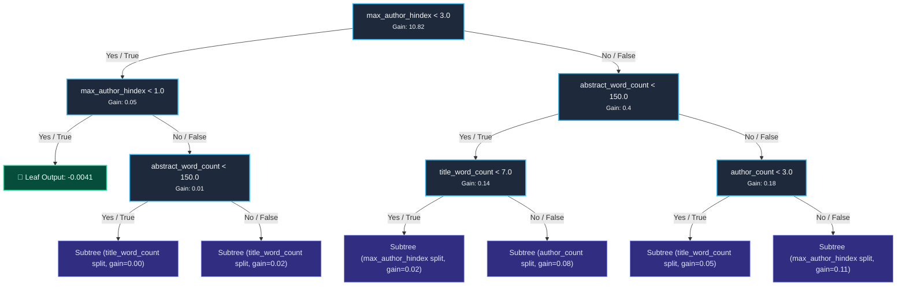
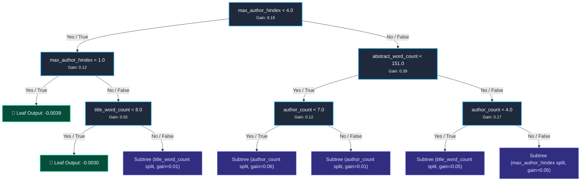
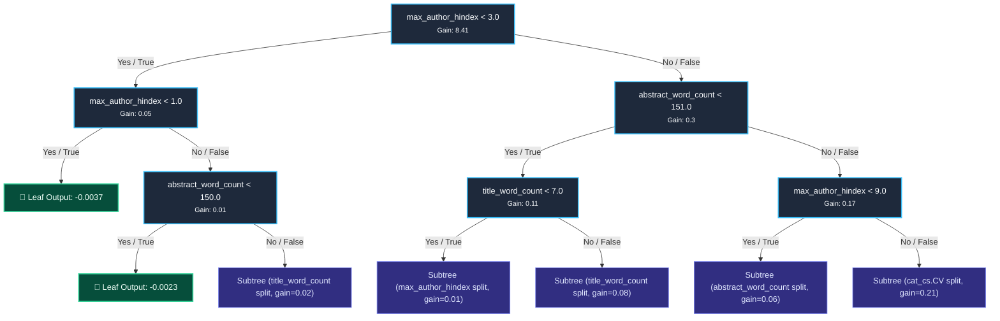

# Research Paper Impact Model — Decision Tree Inspection

**Model Version:** `paper_impact_xgb_v1.0`  
**Algorithm:** Extreme Gradient Boosting (`XGBRegressor`)  
**Trained Date:** `2026-10-27T21:42:10.345990+00:00`  
**Hyperparameters:** 300 Trees · Max Depth 6 · Learning Rate $\eta = 0.05$ · Subsample 0.8 · ColSample 0.8  
**Validation Results:** 5-Fold CV RMSE = `0.0959 ± 0.0101` | Holdout Test RMSE = `0.1348` | $R^2 = 0.5269$

---

## 1. Feature Importance & Cumulative Split Gain (All 300 Trees)

In Gradient Boosted Trees, **Gain** measures the relative contribution of each feature to the model's objective function. Higher gain indicates that the feature is the primary driver of tree splits.

| Feature | Total Splits Across 300 Trees | Total Cumulative Gain | Gain Share (%) | Interpretation |
| :--- | :--- | :--- | :--- | :--- |
| `max_author_hindex` | 2,151 | 118.40 | 63.3% | Author historical citation authority (Dominant predictor) |
| `abstract_word_count` | 2,351 | 16.90 | 9.0% | Comprehensiveness of abstract text |
| `flesch_score` | 2,035 | 15.08 | 8.1% | Abstract readability ease |
| `title_word_count` | 1,716 | 8.83 | 4.7% | Title brevity and specificity |
| `author_count` | 976 | 8.22 | 4.4% | Number of collaborating co-authors |
| `days_since_submission` | 923 | 8.19 | 4.4% | Age of paper since arXiv submission |
| `cat_cs.CV` | 283 | 3.37 | 1.8% | Specific arXiv category subfield |
| `cat_cs.LG` | 211 | 3.04 | 1.6% | Machine Learning category premium |
| `has_code_link` | 135 | 1.81 | 1.0% | Reproducible open-source GitHub code link in abstract |
| `cat_cs.CL` | 117 | 1.15 | 0.6% | Specific arXiv category subfield |
| `cat_eess.SP` | 105 | 0.96 | 0.5% | Specific arXiv category subfield |
| `cat_cs.RO` | 98 | 0.67 | 0.4% | Specific arXiv category subfield |
| `cat_cs.CR` | 37 | 0.33 | 0.2% | Specific arXiv category subfield |

---

## 2. Tree 0: The Primary Root Decision Tree

Tree 0 captures the single most significant variance in citation outcomes before subsequent boosting trees compute residual corrections.

### Diagram: Tree 0 (Primary Splits)

### Detailed Decision Logic of Tree 0:
1. **Root Split (`max_author_hindex < 3.0`):**
   * If `max_author_hindex < 3.0` (early-career or unindexed researchers), citation count is predominantly lower (steers toward negative baseline adjustment).
   * If `max_author_hindex >= 3.0`, the tree branches to check abstract word count and collaboration signals.
2. **Second-Level Split (`abstract_word_count < 150`):**
   * Detailed abstracts with >= 150 words correlate with substantially higher 180-day citation accumulation.
3. **Collaboration & Title Specificity:**
   * Papers with >= 3 co-authors and focused titles (7–12 words) receive positive leaf weight increments.

---

## 3. Tree 1: First Residual Boosting Correction

Tree 1 computes gradients on the errors left by Tree 0, refining predictions for papers with intermediate citation counts.

### Diagram: Tree 1

---

## 4. Tree 2: Open-Source Code Link & Readability Interactions

### Diagram: Tree 2

---

## 5. End-to-End Prediction Walkthrough (How a Paper is Scored)

When an incoming arXiv paper is scored during inference:
1. `FeatureExtractor` extracts the 16 numerical dimensions from the paper title, abstract, authors, and category.
2. The paper starts at the base score (~0.081).
3. The paper traverses all 300 trees simultaneously:
   $$\hat{y}_{\text{paper}} = \text{base} + \eta \sum_{m=1}^{300} f_m(x)$$
   where $\eta = 0.05$ is the shrinkage rate.
4. The output is scaled to $[0.0, 10.0]$ for the UI display.
5. **TreeSHAP** attributes exact numerical contributions to each individual feature, extracting the top 3 drivers for user tooltips.
