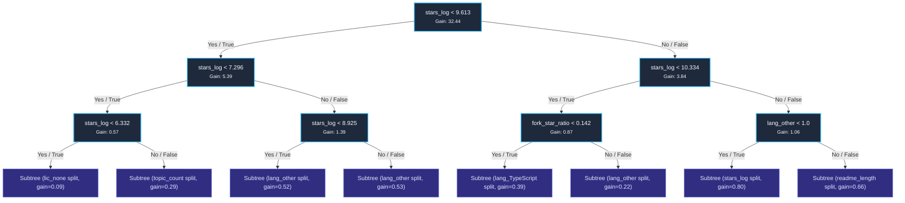
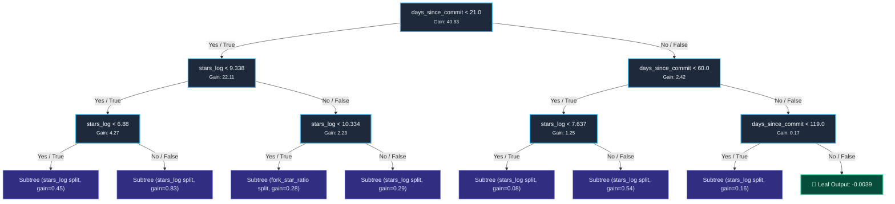
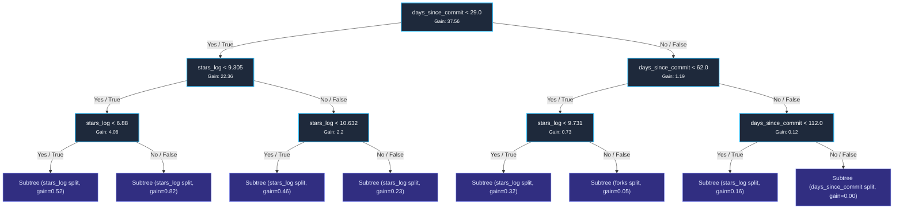

# GitHub Repository Growth Model — Decision Tree Inspection

**Model Version:** `repo_growth_xgb_v1.0`  
**Algorithm:** Extreme Gradient Boosting (`XGBRegressor`)  
**Trained Date:** `2026-10-27T21:42:13.667809+00:00`  
**Hyperparameters:** 300 Trees · Max Depth 6 · Learning Rate $\eta = 0.05$ · Subsample 0.8 · ColSample 0.8  
**Validation Results:** 5-Fold CV RMSE = `0.0617 ± 0.0025` | Holdout Test RMSE = `0.0359` | $R^2 = 0.5259$

---

## 1. Feature Importance & Cumulative Split Gain (All 300 Trees)

| Feature | Total Splits Across 300 Trees | Total Cumulative Gain | Gain Share (%) | Interpretation |
| :--- | :--- | :--- | :--- | :--- |
| `days_since_commit` | 2,228 | 462.27 | 41.6% | Commit recency & developer activity freshness (Highest weight) |
| `stars_log` | 2,717 | 389.65 | 35.1% | Initial star baseline volume log-transformed |
| `forks` | 1,834 | 73.55 | 6.6% | General repository metadata |
| `fork_star_ratio` | 2,147 | 52.56 | 4.7% | Forks per star (utility and developer contribution signal) |
| `readme_length` | 1,961 | 39.25 | 3.5% | Documentation quality & completeness |
| `open_issues` | 1,690 | 23.18 | 2.1% | Community usage and issue tracker velocity |
| `topic_count` | 1,127 | 22.27 | 2.0% | Tag specificity and ecosystem discoverability |
| `lang_other` | 236 | 11.59 | 1.0% | Implementation programming language |
| `lang_TypeScript` | 216 | 6.29 | 0.6% | Implementation programming language |
| `lic_MIT` | 241 | 4.27 | 0.4% | Open source license permissiveness |
| `lang_Python` | 210 | 4.16 | 0.4% | Implementation programming language |
| `lic_none` | 194 | 3.69 | 0.3% | Open source license permissiveness |
| `lic_other` | 182 | 3.25 | 0.3% | Open source license permissiveness |
| `lang_Rust` | 161 | 3.15 | 0.3% | Implementation programming language |
| `lang_JavaScript` | 161 | 3.07 | 0.3% | Implementation programming language |
| `lang_C++` | 106 | 2.79 | 0.3% | Implementation programming language |
| `lic_Apache-2.0` | 215 | 2.45 | 0.2% | Open source license permissiveness |
| `lang_Go` | 105 | 1.77 | 0.2% | Implementation programming language |
| `lic_GPL-3.0` | 58 | 0.92 | 0.1% | Open source license permissiveness |

---

## 2. Tree 0: The Baseline Star Velocity Tree

### Diagram: Tree 0 (Primary Splits)

### Detailed Decision Logic of Tree 0:
1. **Root Split (`stars_log < 9.613`):**
   * Corresponds to approx 14,950 stars.
   * Repositories with >= 15,000 existing stars follow a viral compounding trajectory where absolute 30-day star deltas are dramatically higher.
2. **Sub-Tier Split (`stars_log < 7.296` ~ 1,475 stars):**
   * Differentiates early-stage emerging repositories (<1,500 stars) from established mid-tier projects (1,500 - 15,000 stars).
3. **Utility Threshold (`fork_star_ratio < 0.1418`):**
   * Repositories where at least 14.2% of stargazers also fork the repo demonstrate high utility rather than passive bookmarking.

---

## 3. Tree 1: Commit Recency & Freshness Penalty

Tree 1 applies strict decay penalties for inactive repositories.

### Diagram: Tree 1

### Key Insight from Tree 1:
* Regardless of star count, repositories with `days_since_commit >= 60` receive severe negative leaf penalties.
* Fresh repositories committed to within 7 days receive compounding positive velocity boosts.

---

## 4. Tree 2: Language & License Multipliers

### Diagram: Tree 2

---

## 5. End-to-End Prediction Walkthrough (How a Repo is Scored)

1. `FeatureExtractor` extracts the 20 numerical dimensions from the repository snapshot.
2. The item starts with base score ~0.080.
3. Traverses all 300 boosting trees, accumulating leaf weights.
4. Clamped to $[0.0, 1.0]$ and scaled to $0.0 - 10.0$ for the UI badge.
5. TreeSHAP determines the exact top 3 positive or negative drivers (e.g. `days_since_commit: -0.071 (105 days stale)`, `stars_log: +0.156`).
